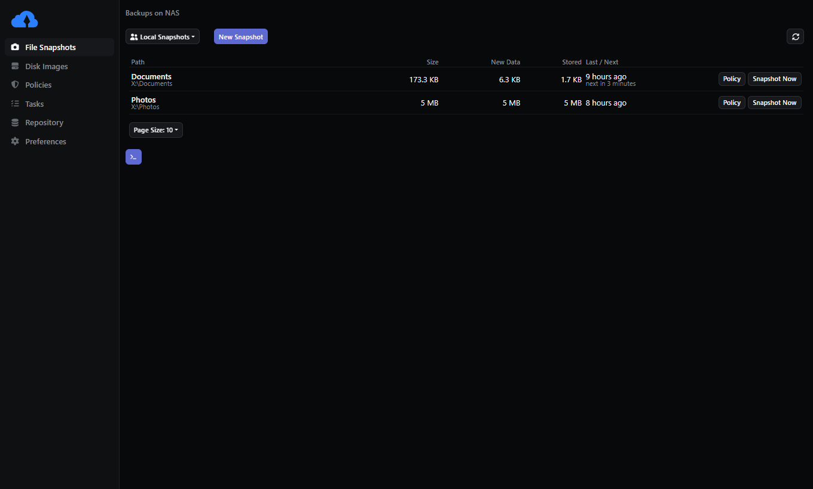
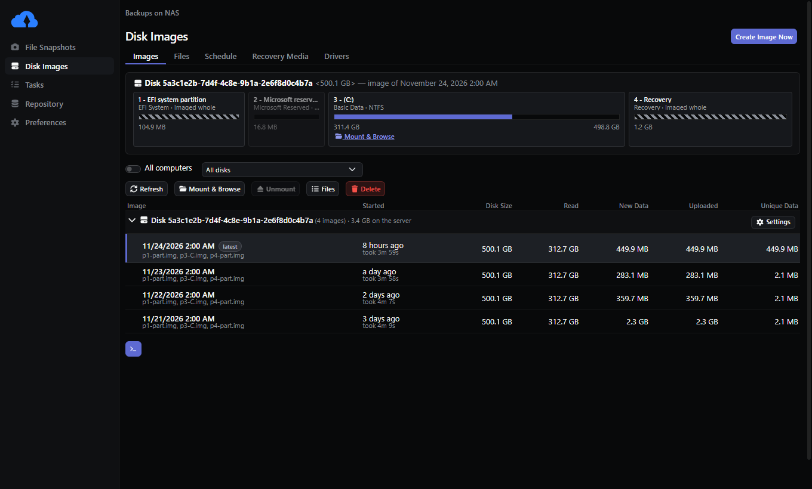
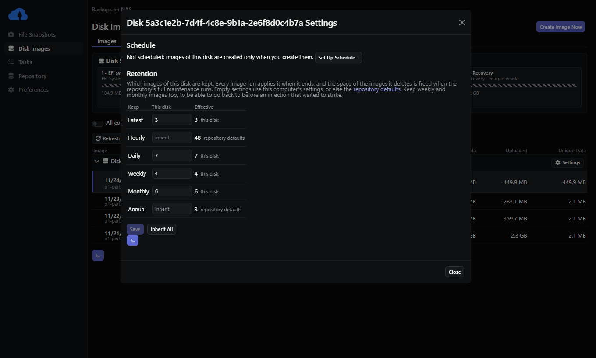

Kopia-Image (personal fork of Kopia with disk images and a Wails-based KopiaUI)
==============================================================================


[](https://github.com/pletch/kopia-image/actions/workflows/release.yml)

> [!IMPORTANT]
> Kopia-Image is a **personal fork** of [kopia/kopia](https://github.com/kopia/kopia). It is not an official Kopia release, is not affiliated with or endorsed by the Kopia project, and is not supported by the Kopia maintainers. Please report problems with stock Kopia upstream, not here, and keep your own backups of anything that matters. Builds are unsigned, so Windows SmartScreen will warn the first time you run the installer.

What this fork adds
---

### Kopia-Image: a lighter KopiaUI built with Wails

The Kopia-Image desktop app (formerly KopiaUI-Wails), in the [`app-wails/`](app-wails) directory, is a replacement for the Electron-based KopiaUI shell, built with [Wails v3](https://v3.wails.io/). It uses the WebView2 runtime that ships with Windows, or WebKitGTK on Linux, and runs the same `kopia server` with this fork's web UI, with:

* a tray icon that starts the `kopia` server, and a single window with a repository selector in its sidebar (one server per repository keeps running behind it)
* native desktop notifications (Windows toasts, or the freedesktop notification service on Linux), including more detailed notices for failed snapshots
* remembered window size, position and active repository
* an error page when the server fails to start, instead of a blank window
* snapshots that run at background priority, so that they yield to whatever you are doing
* on Windows, snapshots mounted as native drives through [WinFsp](https://winfsp.dev/) when it is installed (the installer offers it), falling back to WebDAV otherwise, and an **Unmount Kopia snapshot** entry in Explorer's context menu on the drives it mounts
* a UAC prompt for each action that needs administrator rights, such as creating disk images or recovery media, rather than running KopiaUI elevated
* a small per-user NSIS installer on Windows (no administrator rights needed), and a `.deb` on Linux; both share the repository configuration (`%APPDATA%\kopia` or `~/.config/kopia`) with upstream KopiaUI and the CLI

The web UI comes from this fork's [htmlui](https://github.com/pletch/htmlui) and is served by `kopia server` too, so the browser sees the same changes:

* a left sidebar instead of the top navigation bar, and a dark "linear" theme, the default when the system prefers dark mode; the app's title bar follows the theme's colors
* reworked Snapshots, History, Policies and Tasks tables, with the new data and stored size of each snapshot
* **File Snapshots** lists the folders, with tabs for their Exclusions, Schedule, Actions and Advanced settings, each set for every computer or for this one; a folder's own policy is edited on its page, so the Policies page has left the sidebar
* **Repository › Defaults** sets the retention of every folder and disk at once, and of each computer
* a **Disk Images** page, described [below](#block-level-disk-images-for-windows-kopia-image)



**It uses less memory in most scenarios.** Closing the window shuts WebView2 down completely, whereas Electron keeps its main, GPU and helper processes running. Measured on Windows 11 (private memory, UI shell only; the `kopia.exe` server adds about 140 MB to both):

| | Window open | Window closed (tray only) |
|---|---|---|
| Electron KopiaUI (upstream) | 219 MB | 178 MB |
| Kopia-Image (this fork) | 237 MB | **59 MB** |

With a window open the two are about the same, since both render the page with Chromium. Because KopiaUI spends most of its time in the tray, this fork typically saves about 120 MB of RAM, plus about 350 MB of disk.

### Block-level disk images for Windows (`kopia image`)

Upstream Kopia backs up files and folders only. This fork can also take block-level images of whole Windows GPT disks, for bare-metal restore after a failed drive or ransomware. Images go into the same repository as your file snapshots, encrypted and deduplicated, and work with every storage backend and with a repository server.

* **Full images, deduplicated uploads.** Every image is a complete, independent copy of the disk. NTFS volumes are read from a Volume Shadow Copy, with free space, `pagefile.sys`, `hiberfil.sys` and similar files stored as zeros. Only the 1 MiB chunks the repository doesn't already have are uploaded, and any image can be restored on its own, with no incremental chains to break. How much a nightly image adds depends on how scattered the day's writes are: a 4 KiB change makes its whole chunk new, so a busy developer machine can still add tens of gigabytes before compression, a quieter one much less. `kopia image compare` shows where it comes from. Images made before `0.23.1-wails.40` have 4 MiB chunks, which store an estimated twice as much per night; they still restore, browse and check, but the first image of each disk with the new size shares nothing with them and uploads in full. `--chunk-size` takes 128K to 8M.
* **Leaves out what is recreated anyway.** Files that their programs rebuild are read as zeros, so their churn doesn't enlarge images:
  * kopia's own caches;
  * Windows' `FilesNotToSnapshot` list, which Windows and installed programs maintain (Outlook's mailbox caches, Office's document cache, Windows Update's folder);
  * the safe part of Windows' `FilesNotToBackup` list: temporary files of every profile and of Windows, crash reports and dumps, the BITS queue and event trace buffers;
  * the caches of Chrome, Edge, Brave, Chromium, Vivaldi and Firefox, Windows Update's downloads and the Delivery Optimization cache.

  Each image lists the files it left out, and a restore deletes them, so programs start with no cache instead of a cache full of zeros. Files with other names (hard links) and anything reached through a junction are always imaged. Each source can be turned off (`--exclude-common-caches=false` and so on), and `kopia image create --dry-run` lists what would be left out, by source and folder, without needing a repository.
* **Restore to a disk or file:** a parallel chunk restore to `\\.\PhysicalDriveN` on Windows, `/dev/sdX` on Linux, or a raw image file. The partition table is recreated with the original GUIDs, and the files the image left out are deleted from the restored volumes. Free space is left unwritten, so a mostly empty volume restores in a fraction of the time, and writes to a USB enclosure that stalls are retried. Each image also contains a `restore.sh` for a Linux rescue system.
* **Restore to a smaller disk.** When the target is smaller than the imaged disk, NTFS volumes are shrunk, the largest first and no more than needed, and the partitions after them move down. Files are not moved, so a volume shrinks only as far as its last used cluster; the plan is shown before the target is erased. Verified on virtual disks: the restored volumes pass `chkdsk` with all files identical.
* **Recovery media and a guided restore.** `kopia image recovery-media create` builds a bootable USB stick, a Hyper-V virtual disk, a folder or an ISO file from the computer's own Windows Recovery Environment, with kopia, the repository connection and the storage, network and USB drivers of this computer or others. An ISO file is for keeping until needed and writing to a USB stick with a tool such as [Rufus](https://rufus.ie/); it does not boot as a DVD or in a virtual machine. The media boots into `kopia image recover`, which walks through choosing an image and a target disk and restores it. It can log in to a repository server as another user, so that an account that reads every computer's images can restore any of them. `recovery-media status` says when the media no longer matches the computer, and `recovery-media kit` prints what someone needs to restore it. Images that a restore must clean up need recovery media built with kopia `0.23.1-wails.29` or newer; older media refuses them instead of leaving zero-filled files behind.
* **Restore single files:** browse NTFS volume images file by file and restore single files or folders, downloading only the chunks needed and reading ahead when a file is read through. Image snapshots can also be opened with the web UI's Mount button and over WebDAV, where each NTFS volume appears as a folder. Unless kopia runs as an administrator, browsing hides the credential stores that only administrators can read on the original disk (registry hives, DPAPI keys and the like).
* **Check without restoring.** `image check` confirms every chunk is indexed and stored, and reads back a sample of chunks. `--ntfs` also checks each NTFS file system:
  * the boot sector matches its backup;
  * every MFT record in use is intact;
  * every cluster a file uses is allocated, and used by only one file;
  * every file's parent folder exists.

  This reads only file system metadata: about 7 seconds for a 1 TB system volume with 2.3 million files.
* **Scheduled images and checks:** Task Scheduler tasks that run as SYSTEM, each disk at its own time. They wake the computer, keep it awake while running and retry on failure. A run whose connection to the repository breaks, for example when a laptop switches networks, images again after 30 seconds, 2 and 5 minutes without uploading again what it saved. The tasks also clean up shadow copies left over after a crash or power loss, and record each run's result for monitoring. A run can be paused, resumed or stopped, and shows its progress. Every user can read the tasks' status, so the app shows the next and last run without running as administrator.
* **Measure what an image adds.** `kopia image compare <old> <new>` compares two images of a disk chunk by chunk: how many chunks are new, how much data really changed, how much smaller chunks would have made the image, and which folders caused it.
* **A Disk Images page** in the app and the web UI: the images of each disk with a partition map, Mount & Browse, a Files tab, the schedule with its tasks and progress, Settings for each disk (when it is imaged and how many of its images are kept, over the repository defaults), the recovery media's status and the drivers stored with the images. It shows how much the images of each disk take in the repository, each chunk counted once, and the Unique Data of each image, which deleting it would free. Recovery media can be built from the page, also as an ISO file and with the drivers of every computer. Actions that need administrator rights ask through UAC.

  

  

```
kopia image create C: --dry-run                 # preview the partitions, the zeroed space and what is left out
kopia image create C:                           # image the disk holding C:
kopia image list
kopia image check --ntfs                        # latest image of each source, with file system checks
kopia image compare <old-id> <new-id>           # where an image's new data comes from
kopia image ls <snapshot-id>/p3-C/Users -l
kopia image restore-files <snapshot-id>/p3-C/Users/tim/Documents C:\Recovered
kopia image restore <snapshot-id> --target \\.\PhysicalDrive2 --dry-run
kopia image schedule install C: --at 02:00 --check-day Sun --check-ntfs
kopia image recovery-media create --usb 3       # erase USB disk 3 and make it bootable recovery media
kopia image recovery-media create --iso D:\kopia-recovery.iso
```

Run `kopia image create`, `kopia image schedule` and `kopia image recovery-media create` as administrator. Images use the source `user@host:image:disk:<GUID>`, so retention is a policy like any other: set it in the disk's Settings, on Repository › Defaults, or with `kopia policy set`. MBR disks, dynamic disks, Storage Spaces and ReFS volumes are refused. BitLocker volumes are imaged decrypted, like everything else on the disk including the Windows account database, and are protected only by the repository's encryption. Scheduled runs use a copy of kopia in `C:\ProgramData\kopia\image`: the installer updates it after a UAC prompt, or run `kopia image schedule update` after upgrading. See [Disk Images](site/content/docs/Advanced/Disk%20Images/_index.md) for the details.

> [!WARNING]
> Disk images are new. Restores and recovery media have been tested on virtual disks, in Hyper-V with Secure Boot, and once on real hardware: recovery media saved as an ISO file and written to a USB stick with Rufus restored a 1 TB system disk, which then booted Windows. Windows does not boot from a disk in a USB enclosure, so connect a disk restored that way internally. Restores over Wi-Fi are not yet tested. Test a restore on spare hardware or a virtual machine before relying on images.

### Upstream pull requests not yet merged

This fork carries the following open pull requests from [kopia/kopia](https://github.com/kopia/kopia/pulls). Each will be dropped from the fork once it is merged (or superseded) upstream.

| PR | Change |
|---|---|
| [#5185](https://github.com/kopia/kopia/pull/5185) | Enhance gRPC session management with keepalive and cancellation support |
| [#5364](https://github.com/kopia/kopia/pull/5364) | Avoid serializing concurrent session authentications |
| [#5455](https://github.com/kopia/kopia/pull/5455) | Compute weekly retention bucket in UTC |
| [#5460](https://github.com/kopia/kopia/pull/5460) | Avoid nil-pointer crash when a cache directory is set but caching is disabled |
| [#5461](https://github.com/kopia/kopia/pull/5461) | Detect symlink target changes when reusing cached entries |
| [#5492](https://github.com/kopia/kopia/pull/5492) | Stop cache hits from corrupting LRU size accounting |
| [#5527](https://github.com/kopia/kopia/pull/5527) | Do not deadlock pack GC when deletes keep failing |
| [#5544](https://github.com/kopia/kopia/pull/5544) | Retry failed scheduled snapshots |
| [#5583](https://github.com/kopia/kopia/pull/5583) | Parse time of day using base 10 |
| [#5611](https://github.com/kopia/kopia/pull/5611) | Don't panic when flushing a delete marker after a transient storage failure |
| [#5616](https://github.com/kopia/kopia/pull/5616) | Use actual written size when a file changes during upload |
| [#5639](https://github.com/kopia/kopia/pull/5639) | Avoid holding the server lock during repository refresh I/O |
| [#5674](https://github.com/kopia/kopia/pull/5674) | KopiaUI: wait for server address before loading the repository window |
| [#5719](https://github.com/kopia/kopia/pull/5719) | Reject directory entry names that escape the restore target |
| [#5735](https://github.com/kopia/kopia/pull/5735) | KopiaUI: poll server status only while it can change |
| [#5746](https://github.com/kopia/kopia/pull/5746) | Overwrite read-only files on Windows when restoring |
| [#5769](https://github.com/kopia/kopia/pull/5769) | Separate weekly and monthly retention buckets |
| [#5785](https://github.com/kopia/kopia/pull/5785) | Do not reschedule a snapshot that is waiting for an upload slot |
| [#5797](https://github.com/kopia/kopia/pull/5797) | Skip unrelated filesystem blob metadata reads |

### Repository server features

These are for running `kopia server start` as a shared repository server, for example on a home server that other machines back up to.

On Linux the server runs at background priority by default (nice 10 and the lowest normal disk priority), so it yields to other services and still runs at full speed on an idle machine; a lower priority set by systemd's `Nice=` or `IOSchedulingClass=` is kept, and `--no-background` turns it off. It handles at least 72 requests at once by default (`--max-concurrency`), so that disk images uploading many chunks in parallel don't wait on a small server; one client may use at most 7/8 of them, so the others always get a share.

#### Snapshots served over WebDAV (`--webdav-mounts`)

In upstream Kopia, "Mount as Local Filesystem" in the web UI mounts the snapshot on the server's own machine, which is no use when you browse the UI from another computer. With `--webdav-mounts`, the server instead shares snapshots as read-only WebDAV on its own HTTPS port, protected by the web UI login:

* `https://<server>:51515/webdav/all/` is every snapshot of every source, arranged as `user@host/<path>/<snapshot time>/`. Map it once as a drive, or put it in fstab.
* `https://<server>:51515/webdav/<snapshot root ID>/` is a single snapshot. The web UI's mount button now shows this URL, ready to copy, and nothing is mounted on the server.
* Opening any `/webdav/` folder in a browser lists its contents and offers commands and downloadable scripts that mount that folder: a `.cmd` that maps it to a free drive letter on Windows, and a `.sh` that mounts it with GVfs on Linux.

Mounting by hand:

```
:: Windows (cmd), prompts for the web UI password
net use Z: "https://kopia.example:51515/webdav/all/" /user:kopia /persistent:no

# Linux with GVfs (GNOME Files, Nemo, Caja, Thunar)
gio mount davs://kopia.example:51515/webdav/all/

# Linux with davfs2, in /etc/fstab (credentials go in /etc/davfs2/secrets)
https://kopia.example:51515/webdav/all/ /mnt/kopia davfs ro,user,noauto,_netdev 0 0
```

Windows only connects over HTTPS to a server whose certificate it trusts, and by default the WebDAV client refuses to open files larger than 50 MB. To raise that limit, set `HKLM\SYSTEM\CurrentControlSet\Services\WebClient\Parameters\FileSizeLimitInBytes` to `0xFFFFFFFF` and restart the WebClient service. Only the web UI user can use the WebDAV shares; repository users (`user@host`) cannot.

#### Built-in ACME certificates (`--tls-acme-domain`)

The server can obtain and renew its own TLS certificate from an ACME certificate authority, either Let's Encrypt (the default) or a private CA such as step-ca. It uses the TLS-ALPN-01 challenge, so the CA must be able to reach the server on port 443. Grant the binary `CAP_NET_BIND_SERVICE`, or forward port 443 and set `--tls-acme-alpn-port`.

```
kopia server start --address 0.0.0.0:51515 \
  --tls-acme-domain kopia.example \
  --tls-acme-directory https://ca.example/acme/acme/directory \
  --tls-acme-ca-root /usr/local/share/ca-certificates/my-root-ca.crt
```

`--tls-acme-domain` can be repeated. Accounts, keys and certificates are stored in `acme` next to the config file unless `--tls-acme-storage-dir` is set, and `--tls-acme-email` sets the account contact.

##### DNS-01 challenge with Cloudflare (`--tls-acme-dns-provider`)

With `--tls-acme-dns-provider cloudflare` the CA validates the domains through temporary DNS records instead of connecting to the server, the same way Caddy's Cloudflare DNS module does. The server then needs no inbound port 443, can be reachable only on a private network, and can use wildcard domains such as `*.kopia.example`.

```
kopia server start --address 0.0.0.0:51515 \
  --tls-acme-domain kopia.example \
  --tls-acme-dns-provider cloudflare \
  --tls-acme-cloudflare-api-token-file /etc/kopia/cloudflare-token
```

Create a scoped API token in the Cloudflare dashboard (never the global API key) with the `Zone / Zone / Read` and `Zone / DNS / Edit` permissions, limited to the zone of the certificate's domains. Anyone holding it can change that zone's DNS records, so it is deliberately not accepted as a command-line argument, which other users could read from the process list. Supply it in one of two ways:

- `--tls-acme-cloudflare-api-token-file`: a file that contains only the token and is readable only by the account running kopia (`chmod 600`). This is the preferred way and works with systemd credentials (`LoadCredential=cloudflare-token:/etc/kopia/cloudflare-token`, then `--tls-acme-cloudflare-api-token-file=%d/cloudflare-token`) and with Docker or Kubernetes secrets. The file is read again at every renewal, so a rotated token is picked up without a restart.
- the `KOPIA_ACME_CLOUDFLARE_API_TOKEN` environment variable. The server removes it from its own environment at startup so that snapshot actions do not inherit it, but it remains visible to whatever started the server and, on Linux, in `/proc/<pid>/environ` to the same user and root.

The token is never written to the log or to the ACME storage directory. If the system resolver serves a private view of the zone (split-horizon DNS), add `--tls-acme-dns-resolver 1.1.1.1` so that the server checks the public DNS for the challenge record.

#### Certificate file reload

When the server uses `--tls-cert-file` and `--tls-key-file`, it picks up renewed files within 10 seconds, or straight away on `SIGHUP`, without restarting. An external tool such as certbot or lego can therefore renew the certificate without interrupting backups.

### Robustness and performance fixes

These fixes go beyond upstream Kopia. Each came out of a review of the code paths a backup depends on.

**Repository replication (`kopia repository sync-to`):**

* **Crash-safe copies.** Blobs are copied in dependency order: data packs first, then indexes, then the repository's configuration, with the format blob (`kopia.repository`) last. An interrupted or failed sync therefore never leaves a copy that connects but can't restore, which upstream could do when indexes landed before the packs they point at.
* **Deletes happen last.** With `--delete`, nothing is deleted until every copy has succeeded, and indexes go before the packs they reference. Upstream could delete old blobs while their replacements were still uploading. `--delete` is refused unless the destination already holds a copy of this repository, so it can't wipe an unrelated bucket.
* **Safe while the source is in use.** Indexes are listed before packs, so a snapshot or maintenance running during the sync can't leave an index pointing at a pack that wasn't copied. If blobs disappear mid-copy, the sync fails without deleting anything and asks to be run again, instead of reporting success.
* **Smaller fixes.** `--dry-run` no longer writes to the destination. Configuration blobs are compared by content, not by timestamps from two different clocks. Object-lock retention carries over to destinations that support it, and destinations that don't get a warning. `--max-upload-speed` is honored.
* **Faster.**
  * The source and destination are listed at the same time, each split into prefixes listed in parallel.
  * Copies run 8 at a time instead of 1.
  * The source opens without loading its indexes.
  * Each listed blob takes about a third of the memory.

**Repository server (`kopia server` and clients connected to it):**

* **Re-uploads data marked deleted.** When a client sent data the server reported as already present, it skipped the upload even if that data was marked deleted, so a new snapshot could point at data maintenance later removes. This is rare, but it is a silent loss, and multi-day disk images are where it could happen. The client now uploads such data again, which un-deletes it, as a direct connection does. Image verification also rejects deleted chunks.
* **No more leaked sessions.** Every snapshot or image a long-running client made left a stream open on the server, until after about 250 new sessions hung. Writers now close their own session.
* **One failure no longer drops every upload.** A session that failed to start, for example with access denied, made the client reconnect, which cut every other upload sharing the connection. The client now reconnects only when the connection itself is broken, and a replaced connection stays open until its last session ends.
* **A slow client can't freeze the server.** All responses used to wait on one server-wide lock, so a single stalled client blocked everyone. Each session now sends on its own, and requests still running when a client disconnects finish before its data is flushed.
* **Faster over a WAN.** The server allowed only 1 MiB in flight per connection, which capped uploads at about 33 MB/s at 30 ms of latency. It now allows 32 MiB, enough for about 2.5 Gbit/s at 100 ms. It also pings idle connections, so clients that vanish are noticed.
* **Flush can be cancelled, and no longer crashes.** A client's flush now honors cancellation and timeouts, and it no longer risks a crash when it overlaps with uploads still starting, as during an image's periodic flush.

### Other personal changes

* **Reconnect after sleep:** fixes a gRPC `readLoop` deadlock and reconnects to a repository server cleanly after Windows resumes from sleep.
* **Better failed-snapshot notifications** in the Electron KopiaUI as well (see [app/NOTIFICATIONS.md](app/NOTIFICATIONS.md)).
* **Named snapshot drives on Windows:** a snapshot mounted as a drive letter, from the app or `kopia mount`, appears in Explorer under its source and snapshot time (or "Kopia - All Snapshots") instead of "DavWWWRoot". A drive mounted through WinFsp can be read only by the user who mounted it. A drive the app mounted is unmounted from its context menu in Explorer, or with `kopia server unmount X:`.
* **Snapshots leave last access times alone on Windows.** Where NTFS keeps last access times, upstream kopia's every listing of a folder made NTFS write to the disk, which, every 30 minutes on a large tree, changed thousands of places of the disk that disk images then had to store again. Folders and files are now read without updating them.
* **New data and stored size per snapshot:** every file snapshot and image records how much new data it added, before and after compression, also through a repository server, and the web UI shows both.
* **Fixes not (yet) proposed upstream:**
  * a deleted snapshot manifest no longer comes back when its deletion was saved within the same clock tick as the manifest, which on Windows' coarse clock left stray checkpoint snapshots behind;
  * a content read through a damaged cache entry is fetched from storage again instead of failing until the cache is cleared;
  * `kopia image ls` browses images again (it had been shadowed by an alias of `image list`);
  * a WebDAV drive disconnected with Explorer's Disconnect can be unmounted again, instead of staying mounted until the server restarts.

Installing
---

Releases are numbered `<upstream version>-image.<n>`: `v0.23.1-image.1` is the first Kopia-Image release based on upstream Kopia v0.23.1 (including upstream changes made after v0.23.1; each release's notes name the exact upstream commit). Releases before the rename were numbered `-wails.<n>`; since `image` sorts before `wails`, a `-wails` install does not offer the update, so install it by hand.

Download `Kopia-Image-Setup-<version>.exe` (or the portable zip) from this fork's [Releases](https://github.com/pletch/kopia-image/releases) page. It installs per-user to `%LOCALAPPDATA%\Programs\Kopia-Image` and bundles a `kopia.exe` built from this fork. Existing repositories configured with upstream KopiaUI are picked up automatically. Installing it over KopiaUI-Wails, the app's name before, replaces it: its settings, window positions and "Launch At Startup" are kept, and the old copy is uninstalled.

The same releases include the `kopia` command-line tool for Linux (`kopia-<version>-linux-x64.tar.gz` and `kopia-<version>-linux-arm64.tar.gz`), built from this fork with all of the changes above except the KopiaUI ones. They are static binaries with no dependencies: extract and run `kopia`.

For Debian and Ubuntu on x64 there is also `kopia-wails_<version>_amd64.deb`, installed with `sudo apt install ./kopia-wails_<version>_amd64.deb`. It puts `kopia` in `/usr/bin` and replaces the upstream `kopia` package if that is installed. Because it has a different package name, an upstream Kopia apt repository will not silently switch you back; remove `kopia-wails` and install `kopia` to return to upstream.

Kopia-Image for Linux is `kopia-image_<version>_amd64.deb`, which replaces the `kopiaui-wails` package of earlier releases:

```sh
sudo apt install ./kopia-image_<version>_amd64.deb
```

Like upstream KopiaUI, it includes its own copy of `kopia` (in `/usr/lib/kopia-image/server/`), which it runs as its server, so it does not need `kopia-wails`. Install `kopia-wails` as well if you also want `kopia` in a terminal; the two packages do not conflict.

It is built on Ubuntu 22.04 against GTK 3 and WebKitGTK 4.1, so it runs on Ubuntu 22.04 / Linux Mint 21 and newer and on Debian 12 and newer. Start it from the applications menu as "Kopia-Image". Mounting a snapshot uses FUSE (the `fuse3` package). The tray icon needs a desktop that shows status notifier icons: KDE, Cinnamon and XFCE do, while GNOME needs the AppIndicator extension. Without a tray, starting Kopia-Image again brings its window back.

There are no macOS builds, rpm packages or Docker images.

Building
---

On Windows with Go and NSIS 3 installed, from Git Bash:

```sh
go build -o dist/kopia_windows_amd64/kopia.exe github.com/kopia/kopia
app-wails/build-installer.sh
```

On Linux with Go, a C compiler and the GTK 3 / WebKitGTK 4.1 headers (`sudo apt install build-essential libgtk-3-dev libwebkit2gtk-4.1-dev`):

```sh
app-wails/build-linux-deb.sh   # dist/kopia-image_<version>_amd64.deb
```

To run it from the source tree instead, build with `go build -tags gtk3` in `app-wails/`. Without the tag, Wails builds against GTK 4 and WebKitGTK 6.0.

Pushing a `v<upstream version>-wails.<n>` tag runs the [Release](.github/workflows/release.yml) workflow, which builds the Windows installer and portable zip, the Linux CLI archives, and the `kopia-wails` and `kopia-image` amd64 `.deb` packages, and publishes them as a GitHub release. See [BUILD.md](BUILD.md) for building the rest of Kopia.

About Kopia
---

Kopia is a fast and secure open-source backup/restore tool that allows you to create [encrypted](https://kopia.io/docs/features/#user-controlled-end-to-end-encryption) snapshots of your data and save the snapshots to [remote or cloud storage](https://kopia.io/docs/features/#save-snapshots-to-cloud-network-or-local-storage) of your choice, [to network-attached storage or server](https://kopia.io/docs/features/#save-snapshots-to-cloud-network-or-local-storage), or [locally on your machine](https://kopia.io/docs/features/#save-snapshots-to-cloud-network-or-local-storage). Kopia does not 'image' your whole machine. Rather, Kopia allows you to backup/restore any and all files/directories that you deem are important or critical.

Kopia has both [CLI (command-line interface)](https://kopia.io/docs/features/#both-command-line-and-graphical-user-interfaces) and [GUI (graphical user interface)](https://kopia.io/docs/features/#both-command-line-and-graphical-user-interfaces) versions, making it the perfect tool for both advanced and regular users. You can read more about Kopia's unique [features](https://kopia.io/docs/features/) -- which include [compression](https://kopia.io/docs/features/#compression), [deduplication](https://kopia.io/docs/features/#backup-files-and-directories-using-snapshots), [user-controlled end-to-end encryption](https://kopia.io/docs/features/#user-controlled-end-to-end-encryption), and [error correction](https://kopia.io/docs/features/#error-correction) -- to get a better understanding of how Kopia works.

When ready, head to the [installation](https://kopia.io/docs/installation/) page to download and install Kopia, and make sure to read the [Getting Started Guide](https://kopia.io/docs/getting-started/) for a step-by-step walkthrough of how to use Kopia.

Pick the Cloud Storage Provider You Want
---

Kopia supports saving your [encrypted](https://kopia.io/docs/features/#user-controlled-end-to-end-encryption) and [compressed](https://kopia.io/docs/features/#compression) snapshots to all of the following [storage locations](https://kopia.io/docs/features/#save-snapshots-to-cloud-network-or-local-storage):

* **Amazon S3** and any **cloud storage that is compatible with S3**
* **Azure Blob Storage**
* **Backblaze B2**
* **Google Cloud Storage**
* Any remote server or cloud storage that supports **WebDAV**
* Any remote server or cloud storage that supports **SFTP**
* Some of the cloud storage options supported by **Rclone**
  * Requires you to download and setup Rclone in addition to Kopia, but after that Kopia manages/runs Rclone for you
  * Rclone support is experimental: not all the cloud storage products supported by Rclone have been tested to work with Kopia, and some may not work with Kopia; Kopia has been tested to work with **Dropbox**, **OneDrive**, and **Google Drive** through Rclone
* Your local machine and any network-attached storage or server
* Your own server by setting up a [Kopia Repository Server](https://kopia.io/docs/repository-server/)

And Kopia uses [data deduplication](https://kopia.io/docs/features/#backup-files-and-directories-using-snapshots) to save you money! Read the [repositories help page](https://kopia.io/docs/repositories/) for more information on supported storage locations.

With Kopia you are in full control of where to store your snapshots, that is, you pick the storage provider you want to use. You must provision and pay for the storage provider for whatever storage locations you want to use, and then tell Kopia what those storage locations are. You can even use multiple storage locations for different backup repositories if you want. Kopia also supports backing up multiple machines to the same storage location.

Kopia in Action
---

Using Kopia via command-line interface:

[](https://asciinema.org/a/ykx6uzEhKY3451fWEnX9nm9uo)

Using Kopia via graphical user interface (note: the video is of an older version of Kopia and the interface is different in the current version of Kopia, but the main principles of the interface are the same):

[](https://www.youtube.com/watch?v=sHJjSpasWIo)

Getting Started
---
See [Kopia Documentation](https://kopia.io/docs/) for more information. Also check out the [users forum](https://kopia.discourse.group).

Licensing
---
Kopia is licensed under the Apache License, Version 2.0. See [LICENSE](LICENSE) for the full license text.

Building Kopia
---
See [Build Infrastructure](BUILD.md) for more information on building Kopia and working with the source code.

Contribution Guidelines
---
Kopia is open source. For more information see the [Contribution Guidelines](https://kopia.io/docs/contribution-guidelines/).

Reporting Security Issues
---
If you find a security issue you'd like to disclose privately, please contact `security@kopia.io`.

[](https://app.netlify.com/sites/kopia/deploys)
